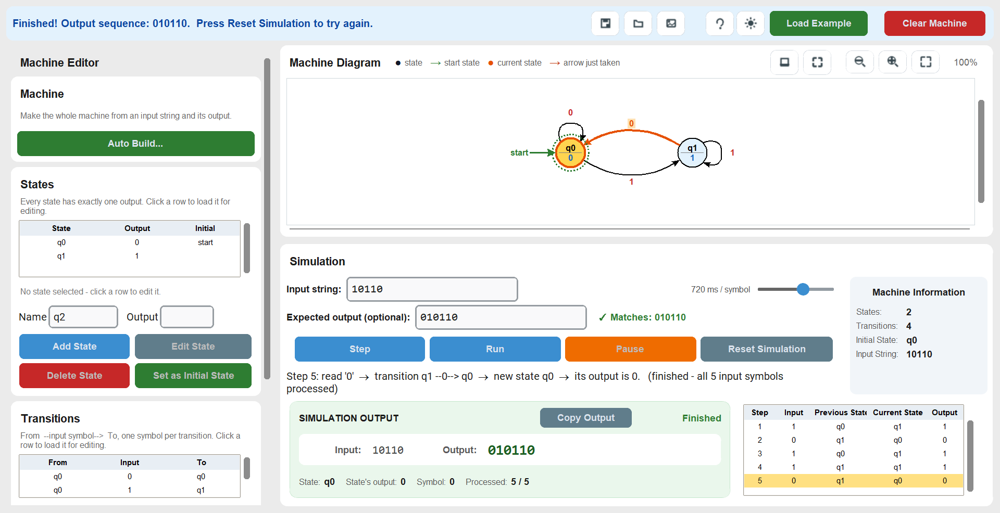
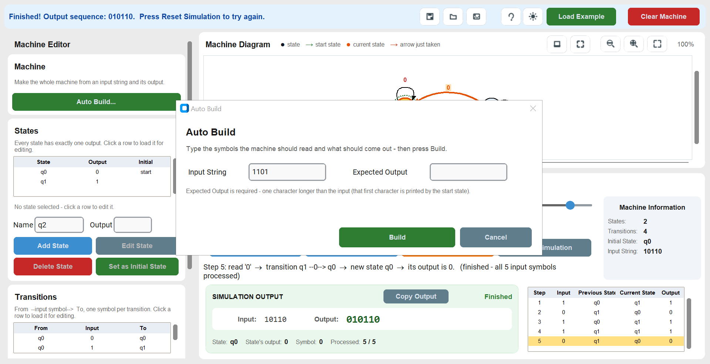

# Moore Machine Simulator

A desktop teaching tool for **Moore machines** — finite-state machines whose output comes from
the *state the machine is sitting in*, never from the input. Build a machine by hand or let
Auto Build work one out for you, then step through it one symbol at a time and watch the output
appear.

Built with Python and [CustomTkinter](https://github.com/TomSchimansky/CustomTkinter).



---

## Contents

- [What it does](#what-it-does)
- [Requirements](#requirements)
- [Install and run](#install-and-run)
- [Build the Windows executable](#build-the-windows-executable)
- [Using it](#using-it)
- [File format](#file-format)
- [Tests](#tests)
- [Project layout](#project-layout)
- [Documentation](#documentation)

---

## What it does

**Machine editing**

- Add, edit and delete states — each state has a name and exactly one output.
- Add, edit and delete transitions (`From —input symbol→ To`), including self-loops.
- Pick the initial state; it is drawn with a green ring and a "start" arrow.
- A live diagram: circles are states, arrows are transitions. Drag a state to move it, zoom in
  and out, or press Fit Diagram to see the whole machine.

**Simulation**

- Type an input string, then **Step** one symbol at a time or **Run** the whole string.
  **Pause** stops mid-run, **Reset** restarts the simulation without touching the machine.
- The current state is highlighted as it is entered, and the arrow just taken lights up.
- A step-by-step results table and an output sequence that fills in as the machine runs.

**Checking your work**

- Type what you *expect* the machine to print into **Expected output (optional)**. The line
  beside it says whether it matches — and if not, exactly where the first difference is.
- **Copy Output** puts the produced sequence on the clipboard.

**Auto Build**

- Give it an input string and the output that string should produce. It works out the states,
  their outputs and every transition, then installs the machine ready to rename.

**Everything else**

- Save to and load from JSON, export the diagram as a PNG.
- Light / dark appearance.
- Every error is explained in plain language with a "Fix:" line telling you what to do next.
- Destructive actions (delete state, delete transition, clear machine, load over an existing
  machine) ask for confirmation first.

---

## Requirements

- **Python 3.10 or newer** (developed and tested on 3.13)
- **tkinter** — included with the official Python installers on Windows and macOS. On
  Debian/Ubuntu install it separately: `sudo apt install python3-tk`
- The two packages in [`requirements.txt`](requirements.txt):

```bash
pip install -r requirements.txt
```

`tkinter` is deliberately not in that file — it is part of the standard library, not a PyPI
package, and listing it makes `pip` fail on some systems.

---

## Install and run

**No Python needed** — a ready-to-run build is committed at
[`dist/Moore Machine Simulator.exe`](dist/Moore%20Machine%20Simulator.exe).
Download it and double-click it.

To run from source instead:

```bash
git clone https://github.com/wynnnn26/moore-machine.git
cd moore-machine
pip install -r requirements.txt
python main.py
```

To run the tests instead of opening the window:

```bash
python main.py --test
```

It runs every suite and exits with code 0 when they all pass. `moore.py` is kept as a thin
forwarder, so the older `python moore.py` and `python moore.py --test` still work too.

---

## Build the Windows executable

`build.bat` installs what it needs first — both the packages in `requirements.txt` and PyInstaller
itself — then runs the build:

```bat
build.bat
```

It does not need anything installed beforehand. This runs
[PyInstaller](https://pyinstaller.org/) in one-file, windowed mode and writes:

```
dist\Moore Machine Simulator.exe
```

Double-click that file to run the simulator — no Python required on the target machine. It also
accepts the same self-check flag:

```bat
"dist\Moore Machine Simulator.exe" --test
```

> `build.bat` ends with a `pause`, so run it from an interactive terminal, or append `< nul`
> when scripting it.

---

## Using it

### Make a machine by hand

1. Under **States**, type a name (e.g. `q0`) and an output (e.g. `0`), then press **Add State**.
   The first state you add automatically becomes the initial state.
2. Under **Transitions**, choose **From State**, type **one** input symbol, choose **To State**,
   then press **Add Transition**.
3. Click a row in either table to load it back into the boxes for editing.
4. Click a state in the list and press **Set as Initial State** to change the start state.

### Let Auto Build work one out

1. Press **Auto Build…** at the top of the Machine Editor.
2. Type an input string, e.g. `10110`.
3. Type the output it should print, e.g. `010110` — **one character longer than the input**,
   because the first character is printed by the start state before any input is read.
4. Press **Build**. Rename the states afterwards if you like.

If the two strings cannot possibly come from one machine, Auto Build says why inside the
dialog and leaves your existing machine untouched.

### Run it

1. Type an input string such as `10110`.
2. Press **Step** to advance one symbol, or **Run** to play the whole string.
3. Optionally type what you expect into **Expected output** to have it checked automatically.



---

## File format

Machines are saved as plain JSON:

```json
{
  "states": {
    "q0": "0",
    "q1": "1"
  },
  "initial": "q0",
  "transitions": [
    { "from": "q0", "input": "0", "to": "q0" },
    { "from": "q0", "input": "1", "to": "q1" },
    { "from": "q1", "input": "0", "to": "q0" },
    { "from": "q1", "input": "1", "to": "q1" }
  ],
  "positions": {
    "q0": [-145.0, -12.0],
    "q1": [152.0, 5.0]
  }
}
```

| Field | Meaning |
|---|---|
| `states` | `{name: output}` — every state and its one output |
| `initial` | the start state's name, or `null` |
| `transitions` | one entry per `From —input→ To` |
| `positions` | optional drag offsets in pixels, so a diagram you arranged stays arranged |

Files are validated on load. Duplicate state names, duplicate transitions, references to states
that do not exist and unusable outputs are all rejected with a readable message, and a rejected
load never damages the machine already open.

---

## Tests

```bash
python main.py --test      # everything
python -m tests            # the same, from the tests package
python -m tests.test_core  # just the machine logic; needs no GUI at all
```

`tests/test_core.py` covers the machine rules directly and asserts that importing `core/` never
pulls in the GUI. `tests/selftest.py` drives the real window: the editing rules, every refusal,
the simulation, the diagram, dialogs and scrollbars — plus the invariant that stepping re-colours
the diagram in place rather than repainting it.

There is also a much larger end-to-end driver (243 UI-level cases across 19 areas — state and
transition CRUD, Moore rules, simulation controls, expected-output checking, Auto Build,
overlays, scrollbars, save/load, PNG export, large machines and performance). It only *drives*
the application and never modifies it, and it is **not published in this repository** — it is a
development tool kept alongside the project. Its last full run after the modular split:
**240 passed, 1 failed, 2 skipped**, the one failure being a deliberate spec check (Auto Build
requires an expected output) and the two skips following from it. The window painted by the
split code was also compared pixel for pixel against the single-file original: **0 of 1,893,120
pixels differ.**

---

## Project layout

```
main.py                         entry point - opens the window, or runs the tests with --test
moore.py                        forwards to main.py, and re-exports the old names for the test driver

core/                           machine logic - no GUI imports anywhere
  constants.py                  DASH, the placeholder shown at step 0
  validation.py                 validate() and check_input(): can it be built, can it run
  simulation.py                 simulate() and out_string(): the Moore rule
  serialization.py              to_dict() / from_dict() - saving and loading JSON
  synthesis.py                  Auto Build: working a machine out from examples

ui/                             the interface
  theme.py                      fonts, button colours, help text, light / dark
  icons.py                      icons drawn with PIL
  widgets/                      reusable controls
    helpers.py                  winfo_exists, auto_hide_bar, Tip
    kit.py                      WidgetKit: card, tree, btn, field, empty_note, ...
  pages.py                      the window, one builder per panel
  dialogs.py                    popups: help, add state, Auto Build
  diagram.py                    the picture: draw, highlight, zoom, pan, drag, export
  app.py                        App - machine state, notifications, editing, simulation

tests/                          automated tests
  test_core.py                  machine logic on its own, without the GUI
  selftest.py                   the end-to-end self-check behind --test

assets/                         screenshots used by this README

requirements.txt                the two runtime dependencies
build.bat                       installs requirements, then runs PyInstaller
Moore Machine Simulator.spec    PyInstaller spec (rewritten by build.bat)
dist\Moore Machine Simulator.exe  the built application
README.md                       install, build and usage
DOCUMENTATION.md                a guided tour of the source
```

Dependencies point one way: `core` never imports `ui`, and the mixins under `ui/` never import
`App`, so there are no cycles.

---

## Documentation

- **[README.md](README.md)** — this file: install, build and usage.
- **[DOCUMENTATION.md](DOCUMENTATION.md)** — a guided tour of the source: how it is organised
  across `core/`, `ui/` and `tests/`, what each part does, and the decisions behind the design.

---

## Licence

All rights reserved unless the author states otherwise.
